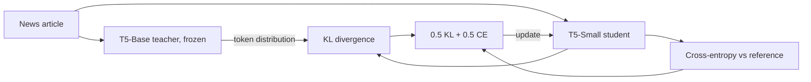

# T5 Knowledge Distillation for Summarization

Distillation of a news-summarization T5-Base teacher into T5-Small, about a third of its size. After
3 epochs of distillation on the Kaggle News Summary dataset, the student keeps **about 90% of the
teacher's ROUGE** (90.8% ROUGE-1, 89.5% ROUGE-2, 90.3% ROUGE-L) and **84.7% of its BERTScore**.

## Why

Summarization models are often deployed where a base-size model is too slow or too large. The
question here is how much of a specialized teacher's quality a much smaller student can keep when
it learns from the teacher's output distribution rather than from the reference summaries alone.

## How it works

The teacher is `mrm8488/t5-base-finetuned-summarize-news`, a T5-Base already fine-tuned on this
dataset; it stays frozen. The student starts from the general `google-t5/t5-small` checkpoint. For
each article both models score the reference summary, and the student is trained on an equal mix of
two losses: KL divergence to the teacher's token distribution (temperature 1.0) and cross-entropy on
the reference summary.



## Evaluation and results

Both models summarize 100 articles, scored with ROUGE F1 and BERTScore F1 (`roberta-large`).
Retention is the student score as a percentage of the teacher score.

| Metric | Teacher (T5-Base) | Student (T5-Small) | Retention |
|---|:-:|:-:|:-:|
| ROUGE-1 | 0.2297 | 0.2086 | 90.8% |
| ROUGE-2 | 0.1407 | 0.1259 | 89.5% |
| ROUGE-L | 0.1771 | 0.1599 | 90.3% |
| BERTScore | 0.1747 | 0.1480 | 84.7% |

The goal is retention, not absolute quality: the teacher's scores depend on its original
fine-tuning, which was not done here.

## Limitations

- The 100 evaluation articles are drawn from the same CSV used for distillation, so the scores
  measure agreement on seen data, not generalization.
- Small evaluation set and a single run; retention figures carry noticeable variance.
- No comparison against a student fine-tuned on references alone, so the gain attributable to the
  teacher signal is not isolated.

## License and citation

Released under the MIT License (see `LICENSE`). If you use this work, please cite:

```bibtex
@misc{chawla2025t5distillation,
  author       = {Chawla, Naman},
  title        = {T5 Knowledge Distillation for Summarization},
  year         = {2025},
  howpublished = {\url{https://github.com/palindromeRice/Knowledge_Distillation_T5}}
}
```
